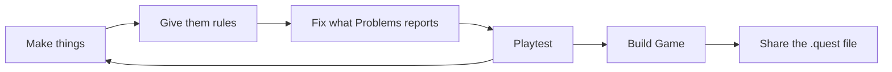

# How Quest Forge works

In Quest Forge you **describe** a game and the **engine plays** it. You never write code. You say what the
rooms look like, what's in them, and what happens when the player clicks on things. The engine does the rest:
walking, drawing, text, saving and loading.

## A project is a folder

Each game you make is a **project**: one folder on your computer. It holds your game's settings, scenes, items,
characters and conversations as plain files, plus the pictures and sounds you import. Quest Forge reads and
writes that folder for you. You never need to open the files yourself.

## The same engine everywhere

The engine that plays your game is the same in every place it runs:

- In **Playtest**, inside the editor, while you work.
- In any web browser, once you **Build Game** into a single `.quest` file and share it.

So what you see in Playtest is what your players get.

## The working loop

Making a game is a loop you go round many times:

1. **Make things**: scenes, objects, items, characters.
2. **Give them rules** that say what happens when the player clicks on them.
3. **Fix what Problems reports.** Quest Forge checks your game as you work and lists anything that's broken.
4. **Playtest** to try it.
5. When it's ready, **Build Game** and **share** the `.quest` file.

## The editor at a glance

The editor window has four areas:

| Area | Where | What it's for |
|---|---|---|
| **Project Browser** | Left | Everything in your game, sorted into Scenes, Items, Characters, Dialogues, Flags, Audio and Images. |
| **Editor tabs** | Middle | Whatever you're working on: a scene, an item, a character, a dialogue or an image. Double-click something in the Project Browser to open it. |
| **Inspector** | Right | The details and rules of whatever is selected. |
| **Problems** | Bottom | Everything that's wrong with the game right now. |

At the top, the title bar has **Undo**, **Redo**, **Save** and **Play**.

:::note Note
Quest Forge doesn't save automatically. Click **Save** (⌘S / Ctrl+S) to write your changes to the project
folder.
:::

## Where to next

Read [The building blocks](./02-building-blocks.md) to meet the things every game is made of.
