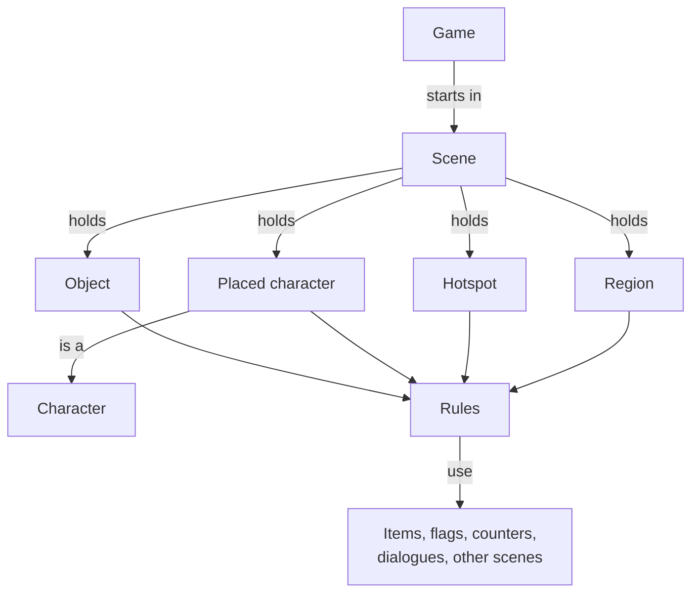

# The building blocks

Every Quest Forge game is made from the same small set of building blocks: a game, its scenes, the things
in those scenes, and the items, characters and conversations the player meets along the way. Once you know
what each one is for, every part of the editor makes sense, because each panel is just a way of making or
changing one of them.

## The game

The **game** is your whole adventure. It decides where play starts, how many points there are to score, and
what the narrator says when the player tries something you didn't plan for. You find it at the top of the
**Project Browser**, in the row called **Game**.

## Scenes

A **scene** is one room or screen: a garden, a shed, the inside of a cave. The player is always in exactly one
scene. Every scene is the same size, 640 by 400 pixels, and has a **background**: the painting the player sees.

A scene also has a floor plan that the player never sees:

- **Walkable area**: where characters can walk. You draw its outline, and holes for anything they can't walk
  through, like a pond.
- **Depth lines**: a far line and a near line. Characters look smaller near the far line and full size near the
  near line, so they seem to walk into the distance.
- **Spawn points**: named places where the player appears, like the doorway they come in through.

## What's in a scene

On top of the background, a scene holds the things the player looks at, touches and talks to.

| Building block | What it is | Example |
|---|---|---|
| **Object** | A picture placed in the scene. It can be clicked, hidden, animated or walked around. | A flowerpot, a rock, a door that opens. |
| **Placed character** | A character standing in this scene. | The gardener, by the shed. |
| **Hotspot** | A clickable area drawn over part of the background. | A pond painted into the background. |
| **Region** | An invisible area of floor that does something when the player walks into it. | The path that leads to the next scene. |

:::tip Tip
Use an object when the thing needs its own picture (because it moves, appears or disappears). Use a hotspot
when it's already painted into the background.
:::

## Things that belong to the whole game

Some building blocks aren't tied to one scene.

- **Items** are things the player can carry: a fishing rod, a coin. An item has a name, a description and an
  icon. The player only has it once something in the game gives it to them.
- **Characters** are people, including the player's own character. A character has a name and its animations
  (walking, talking and standing in each direction). The player's character appears at a spawn point; any
  other character appears in a scene when you place it there.
- **Dialogues** are conversations: the lines characters say and the choices the player picks from.
- **Flags and counters** are the game's memory. A flag is true or false ("the gate is open"). A counter is a
  whole number ("coins found: 3").
- **Images and audio** are the pictures and sounds you import. Backgrounds, objects, icons, animations, music
  and sound effects all use them.

## Rules make it happen

None of the building blocks do anything on their own. **Rules** do. A rule says **When** something happens,
**If** some things are true, **Do** these actions. "When the player uses the fishing rod on the pond, if they
haven't caught the fish yet, give them the fish."

Objects, placed characters, hotspots, regions, scenes and the game itself can all have rules.
[Rules: how a click becomes an action](./03-rules.md) explains exactly how they run.

## How it fits together

The game starts in one scene. Each scene holds objects, placed characters, hotspots and regions, and each
placed character is one of your characters. All four can have rules, and the rules are what connect
everything else: they give items, set flags, start dialogues and move the player to other scenes.

## Names and IDs

Everything has a **name** and an **ID**.

- The **name** is what the player reads: "fishing rod". Change it whenever you like.
- The **ID** is what rules use to find it: `rod`. Quest Forge makes one for you from the name.

If you change an ID with **Change ID…**, every rule that uses it is updated too. To see everything that uses
something, select it and look under **Used by** in the **Inspector**.

:::note Note
An object with no name is scenery: the player sees it but can't click it.
:::

## Folders

You can sort anything in the **Project Browser** into folders, such as one folder of scenes per chapter.
Folders are only for you. They never change how the game plays.

## Where to next

Next, [Rules: how a click becomes an action](./03-rules.md) explains how the player's clicks turn into what
happens on screen. To start making things, see [Build a scene](../02-guides/03-build-a-scene.md) and
[Make things interactive](../02-guides/04-make-things-interactive.md).
