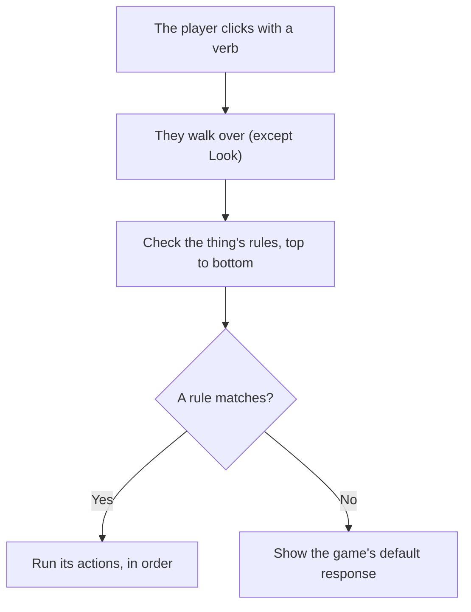

# Rules: how a click becomes an action

Everything that happens in your game happens because of a **rule**. When the player clicks on the pond, a
rule decides whether they see a line of text, catch a fish, or walk to the next scene. Once you know how
Quest Forge picks which rule runs, you can build any puzzle.

## Verbs

The player acts through **verbs**. They pick one from the icon bar at the top of the game, then click on
something in the scene.

| Verb | What the player is doing |
|---|---|
| **Walk** | Walking somewhere. |
| **Look** | Looking at something. |
| **Hand** | Touching, taking, pushing or opening something. |
| **Talk** | Talking to someone (or something). |
| **Use** | Using an item from their inventory on something. |

For Hand, Talk, Use and Walk, the player first walks over to the thing. For a hotspot they walk to its
walk-to point; otherwise they walk to the nearest place they can stand. Look happens from where the player is
standing.

## What a rule says

Every rule reads like a sentence in three parts:

- **When**: the trigger. "When the player uses the fishing rod on this."
- **If**: conditions that must all be true. "If they don't have the big fish yet."
- **Do**: actions, run one after another. "Narrate 'You caught a fish!', give the big fish, award 5 points."

A rule with no conditions always matches its trigger.

## Which rule runs

A thing can have many rules. When the player clicks on it, Quest Forge checks that thing's rules **from top
to bottom** and runs **the first one that matches**: its trigger is the verb (and item) the player used, and
all its conditions are true. Only that one rule runs.

The player picks a verb and clicks on something. Unless the verb is Look, they walk over to it. Quest Forge
then checks that thing's rules in order. If one matches, its actions run. If none does, the narrator gives
the game's **default response** for that verb, such as "Nothing happens."

:::tip Tip
Put your most specific rules at the top. For example, put "When Use with fishing rod, If the player has the
bait" above "When Use with fishing rod" with no condition. The second one then only runs when the first
doesn't.
:::

## Once and first time

- A rule marked **Once** only ever runs one time. After that Quest Forge skips it and checks the next rule.
- The **First time** condition is true until its rule has run. Use it for something that should happen
  differently the first time, while a later rule handles every time after.

## Other triggers

Clicks aren't the only triggers:

| Trigger | When it fires | Whose rule |
|---|---|---|
| **Player walks in** | The player walks into a region. | The region's |
| **Player enters the scene** | The player arrives in a scene. | The scene's |
| **Player leaves the scene** | The player is about to leave a scene. | The scene's |
| **Combine** | The player uses one inventory item on another. Either order works. | The game's |
| **Dialogue ends** | A conversation reaches its end. | The game's |

## Where to next

Rules change the game as it's played. [What the game remembers](./04-game-state.md) explains what those changes
are. To write your first rules, see [Make things interactive](../02-guides/04-make-things-interactive.md).
