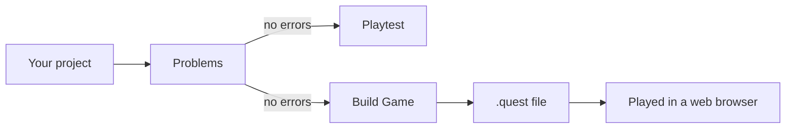

# From editor to player

Your game goes through three steps on the way to a player: Quest Forge **checks** it, you **playtest** it,
and you **build** it into a file to share.

Quest Forge checks your project for problems. When there are no errors, you can playtest it inside the editor
or build it into a `.quest` file. Anyone can play that file in a web browser.

## Problems

Quest Forge checks your game all the time and lists what it finds in the **Problems** panel:

- **Errors** are things that would break the game, like a rule that changes to a scene that doesn't exist.
  While there are errors, you can't playtest or build.
- **Warnings** are things that are probably mistakes, like a scene nothing leads to or an item no rule ever
  gives. They don't stop you playing.

Click a problem to jump straight to the thing that needs fixing.

## Playtest

Click **Play** to run your game inside the editor. You can start from the beginning, from the scene you're
editing, or from a saved point. While it runs, you can see and change the game state, and read a log of every
click, rule and action.

Playtest plays what's in the editor right now, including changes you haven't saved.

## Build Game

When your game is ready, **File ▸ Build Game…** packs everything into one `.quest` file: every scene, rule,
picture and sound. Like Playtest, it builds what's in the editor, including unsaved changes.

## Playing a `.quest` file

Anyone can play a `.quest` file on the Quest Forge website: they open the **Play** page and choose the file.
It works in any modern web browser, on a computer, tablet or phone. Players don't need Quest Forge.

## Where to next

See [Test your game](../02-guides/09-test-your-game.md) and [Share your game](../02-guides/10-share-your-game.md).
